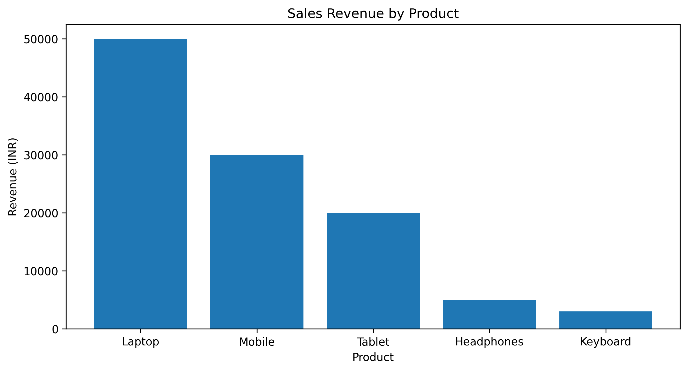

# customer-sales-analysis
Beginner python project for analyzing customer sales data

# My Data Analytics Portfolio

## About Me
I have a background in engineering, international business management, sales, and operations.

I am currently developing my skills in Python, Data Analysis, Power BI, and Machine Learning.

## Skills
- Python
- Pandas and NumPy
- Excel
- Power BI
- Data Visualization
- Business Analysis

## My Projects
1. Sales Data Analysis - Planned
2. Business Performance Dashboard - Planned
3. Customer Churn Prediction - Planned

## Career Goal
To apply my business experience and analytical skills to solve real-world business problems.

  ## Sales Data Analysis Project

### Project Objective
Analyze sales revenue across five product categories
using Python and pandas.

### Tools Used
- Python
- Pandas
- Matplotlib
- Google Colab
- GitHub

### Key Findings
- Total Revenue: INR 108,000
- Total Quantity Sold: 58
- Average Revenue per Product Category: INR 21,600
- Highest Revenue Product: Laptop
- Laptop Revenue Contribution: 46.3%

### Sales Visualization

### Business Recommendations
- Investigate why laptops generate the highest revenue.
- Analyze whether low-revenue products need better marketing.
- Collect profit and cost data before making inventory decisions.

### Project Files
- sales_data.csv: Sample sales dataset
- sales_analysis.ipynb: Python analysis notebook
- sales_chart.png: Sales visualization

### Project Status
Completed as a beginner data analysis project.
